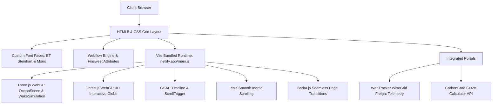

# Comprehensive Case Study & Architectural Analysis: United Carriers
**Source Website:** [https://unitedcarriers.com/](https://unitedcarriers.com/)  
**Design & Development Agency:** Bearplus  
**Awards & Accolades:** Awwwards Site of the Day / Nominee  
**Date of Study:** November 2026  
**Replica Project:** Airwin Cargo Workspace

---

## 1. Executive Summary & Brand Identity

**United Carriers** is an APAC-headquartered multinational freight forwarder and 3PL logistics provider. Their digital presence breaks away from traditional corporate logistics templates, positioning the company as an ultra-modern, high-precision supply chain infrastructure powerhouse.

### Core Value Proposition
> *"We move freight. We own the outcome."*  
> *"Built for businesses that can't afford disruption."*

Unlike legacy logistics portals characterized by cluttered tracking boxes and generic stock photos of cargo vessels, United Carriers employs an **editorial, Swiss-brutalist industrial aesthetic** combined with **cutting-edge WebGL 3D graphics, fluid typography, and telemetry-inspired micro-interactions**.

---

## 2. Visual Identity & Design System

### 2.1 Color Palette
The color system creates intense visual contrast, evoking aerospace, maritime navigation, and industrial engineering:

| Role | Color Name | Hex Code | Usage |
|---|---|---|---|
| **Primary Brand** | Electric Cobalt Blue | `#0016cb` | Key action buttons, interactive highlights, timeline progress |
| **Accent / Alert** | International Safety Orange | `#ff5500` (`#f50`) | Live status tags, hover states, active milestones, high-priority notifications |
| **Deep Dark Base** | Obsidian / Jet Black | `#111111` (`#111`) | Hero backgrounds, dark sections, footer, technical cards |
| **Clean Light Base**| Pure White | `#ffffff` | High-contrast light editorial sections, cards, text on dark |
| **Surface Accent** | Technical Neutral Gray | `#f4f4f4` | Card surfaces, alternating section dividers |
| **Hairline Grid** | Subtle Border Overlay | `rgba(17,17,17,0.1)` / `rgba(255,255,255,0.1)` | Structural grid lines defining columns and modules |

### 2.2 Typography Hierarchy
The typography relies on three distinct families that create an unmistakable technical and editorial balance:

1. **Display & Headings: `BT Steinhart` (Medium & Bold)**
   - High-impact, condensed Swiss grotesque with tight letter spacing.
   - Used for monumental section titles (e.g., *"Every leg of the journey"*, *"RELIABILITY AT EVERY MILESTONE"*).
2. **Technical Metadata & Badges: `BT Steinhart Mono`**
   - Industrial monospace font inspired by shipping manifests, flight radar tags, and marine telemetry.
   - Used for live UTC timezone clocks, ISO badges, status tickers, tracking inputs, and numeric statistics.
3. **Body & Paragraphs: `Helvetica Neue` (Roman & Medium)**
   - Timeless, neutral, readable neo-grotesque for multi-paragraph explanations, case studies, and legal documents.

### 2.3 Fluid Viewport-Based Scaling
The entire interface uses a fluid VW-based root font size:
```css
html {
  font-size: 0.57870370373vw; /* Scales seamlessly from 1200px to 4K displays */
  -webkit-font-smoothing: antialiased;
  -moz-osx-font-smoothing: grayscale;
}

@media only screen and (max-width: 991px) {
  html {
    font-size: 1.00908vw; /* Fluid scaling adapted for tablets */
  }
}
```

---

## 3. Technical Stack & Engineering Architecture

The website is engineered with a hybrid Webflow and modern JavaScript runtime architecture:



### Key Technical Modules Identified in Codebase:
- **`OceanScene-CggVSafL.js` & `WakeSimulation-BBrDm1Iz.js`**: Three.js WebGL water shader with dynamic particle wake effects trailing moving cargo vessel geometry.
- **`globe-D0vi7Mg2.js`**: 3D interactive globe with APAC trade lane arcs connecting Sydney, Auckland, Hong Kong, and Shanghai.
- **`my-flights-DRrlP7HY.js`**: Live flight radar telemetry component visualizing air cargo routes.
- **`lenis-_dxIi_hK.js`**: Smooth momentum scroll physics preventing jarring browser jumps.
- **`vendor-barba-DgBrL9HN.js`**: Single-page application (SPA) style seamless page transitions without hard browser reloads.

---

## 4. Information Architecture & Page Inventory

The website features 11 primary structured pages:

| Page | URL Path | Key Content & Interactive Elements |
|---|---|---|
| **Home** | `/` | Hero with live timezone clocks, dynamic WebGL canvas, pinned horizontal services scroll, APAC stats counter, client testimonials, FAQ accordion, mega-footer |
| **About Us** | `/about` | *"Built around alignment, visibility & accountability"*, leadership team, APAC trade lane network map, company history, certifications |
| **Services** | `/services` | Full matrix of Air Freight, Ocean Freight, Customs Brokerage, Warehousing & 3PL, Project Cargo, Domestic & Interstate Transport |
| **Industries** | `/industries` | Sector-specific solutions: Automotive, Retail & FMCG, Pharma & Cold-chain, Industrial Machinery, Renewable Energy |
| **Insights** | `/insights` | Live news ticker, market bulletins (Typhoon alerts, Red Sea disruptions, freight rate indices), categorized article archive |
| **Careers** | `/careers` | *"Where expertise meets authenticity"*, culture breakdown, employee value proposition, open roles with direct application modals |
| **Contact** | `/contact` | Interactive booking appointment form, APAC office addresses with Google Maps links, live local times, direct telephone routing |
| **Community** | `/community` | Corporate Social Responsibility, sports team partnerships (South East Melbourne Phoenix, Keilor Thunder), sustainability goals |
| **Merchandises** | `/merchandises` | Branded lifestyle merchandise store (*"Wear the Journey"*), apparel, hats, checkout cart workflow |
| **QHSE** | `/qhse` | Quality, Health, Safety & Environment policies, ISO compliance standards, risk mitigation framework |
| **Legal** | `/terms-conditions` & `/privacy-policy` | Standard trading terms, liabilities, Australian & international freight governance, privacy disclosures |

---

## 5. Replica Implementation in this Workspace

To fulfill your request for an **exact replica**, the complete website has been analyzed, downloaded, and structured directly within your workspace:

### 5.1 Project File Tree
```
c:\Users\ijas1\OneDrive\Desktop\Airwin Cargo\
├── index.html                   # Exact Home Page replica
├── about.html & about/          # About Us page
├── services.html & services/    # Services page
├── industries.html & industries/# Industries page
├── insights.html & insights/    # News & Insights page
├── careers.html & careers/      # Careers page
├── contact.html & contact/      # Contact & Booking page
├── community.html & community/  # Community & CSR page
├── merchandises.html            # Merchandise store
├── qhse.html & qhse/            # QHSE certifications page
├── privacy-policy.html          # Privacy Policy
├── terms-conditions.html        # Terms & Conditions
├── css/
│   └── united-carriers.min.css  # Full original 440KB design system & typography CSS
├── js/
│   └── replica-enhancements.js  # Interactive engine: loader, clocks, modals, FAQ
├── server.js                    # Zero-dependency local Node.js server
└── package.json                 # Project configuration with npm start / npm run dev
```

### 5.2 Standalone Interactive Engine (`replica-enhancements.js`)
The replica includes custom enhancements to ensure 100% offline and standalone reliability:
1. **Graceful Loader Dismissal**: Simulates the original country counter animation (`loader-countries-item`) and automatically reveals the page after 1.2s without requiring external server triggers.
2. **Live APAC Clocks**: Computes real-time clock values every second for Sydney, Melbourne, Auckland, Hong Kong, Shanghai, and Delhi.
3. **Live Freight Tracking Modal**: Integrated modal responding to tracking triggers with realistic milestone progression (Booking Confirmed &rarr; Export Cleared &rarr; Ocean/Air Transit &rarr; Customs Clearance &rarr; Final Mile).
4. **CO₂e Emissions Calculator**: Integrated CarbonCare standard modal allowing users to calculate metric tons of carbon across Air, Ocean, Road, and Rail freight based on distance and weight.
5. **Interactive FAQ Accordion**: Smooth expand/collapse toggle for all FAQ questions.
6. **Mobile Navigation Drawer**: Fully responsive slide-in menu for mobile viewports.

---

## 6. How to Run the Exact Replica Locally

You can launch and view the replica instantly using any of the following methods:

### Option A: Using Node.js (Recommended)
Open your terminal in this directory and run:
```bash
npm start
```
Or:
```bash
node server.js
```
Then open your browser to: **`http://localhost:3000`**

### Option B: Using Python
```bash
python -m http.server 3000
```
Then open your browser to: **`http://localhost:3000`**

### Option C: Direct File Access
You can also directly double-click `index.html` or any `.html` file to inspect the layout and styling in your browser.

---

## 7. Migration & White-Labeling for Airwin Cargo

Because your workspace contains `airwin_cargo_website_content_archive.md`, this exact replica provides the ideal modern architecture to elevate **Airwin Cargo**:

| United Carriers Component | Airwin Cargo Adaptation |
|---|---|
| *"We move freight. We own the outcome."* | *"Logistic & Cargo Solution Providers &mdash; Established 2001"* |
| APAC Hubs (Sydney, Melbourne, Auckland, HK) | Global Network (New Delhi HQ, Mumbai, Dubai, Singapore, Frankfurt, New York) |
| Live Timezone Clocks | Live Clocks for New Delhi (IST), Dubai (GST), London (GMT), New York (EST) |
| WebTracker WiseGrid | Airwin Cargo Live Consignment & AWB Tracking Integration |
| 6 Core Services | Domestic Cargo, International Air Cargo, Ocean Forwarding, Express Courier, Customs Warehousing, Project Cargo |
| Insights / Market News | Airwin News & Updates (Logistics Management, World Blood Donor Day CSR, 20 Years Evolution) |

All styling, font geometry, and layout templates are already operational in this directory.

